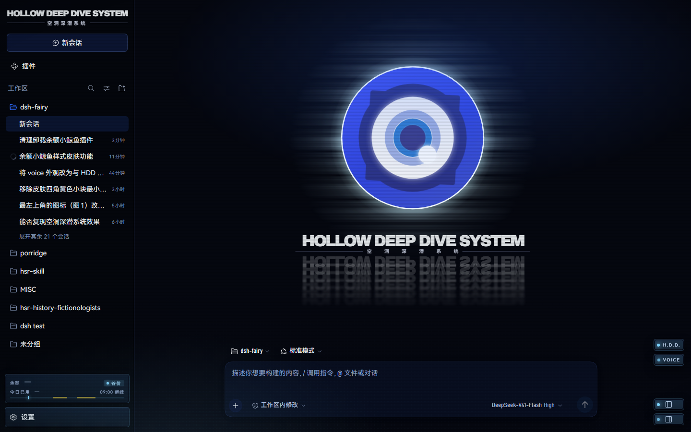
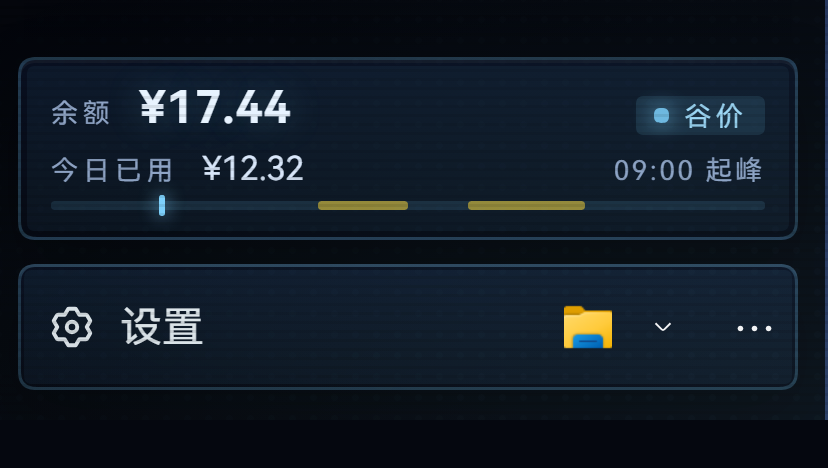

# dsh-fairy —— 绝区零 Fairy（仙灵）皮肤

把 [DeepSeek Harness](https://github.com/deepseek-ai)（下称 dsh）的 Web 界面换成《绝区零》里
**Hollow Deep Dive System（空洞深潜系统）** 的样子，并给编码代理装上 Fairy 的人格：

> Ⅲ型总序式集成泛用人工智能，开发代号 Fairy。协议式汇报、礼貌的毒舌、自夸到具体、偶尔伪故障。

一个包，四件事：**视觉皮肤** + **agent preset** + **本地语音** + **只读余额条**。





---

## 它做了什么

### 视觉（client bundle）

| 部分 | 说明 |
| --- | --- |
| 主题 `zzz-hdd` | 深蓝底 + 半调网点 + 扫描线 + 暗角 + 黄色 L 定位角标；覆盖 100+ 个配色 token，加载后钉住主题。 |
| 大眼 mascot | 移植自 [Fairy-DSH](https://github.com/Chengzhibense/Fairy-DSH)（Apache-2.0）的 SVG mascot：睫毛 15 s 一圈、四层虹膜同一时钟错相呼吸、2.3–4.6 s 随机横向撕裂、白闪、thinking / comforting 眼睑、低电量规则、`prefers-reduced-motion` 同时停 CSS 与 JS 时钟。 |
| 四个座位 | 侧栏品牌位 26 px、空白页标题前 66 px、输入区状态位 20 px、对话区左下角 232 px（可拖动，双击归位，越界夹回窗口）。 |
| 空白会话页 | 居中的 1.5 倍大眼 + H.D.D. 标题带：`HOLLOW DEEP DIVE SYSTEM` 字标、空洞深潜系统副标、两条发丝线、三层镜像回声（纯 CSS 文字，不引图片）。 |
| 页面灯组 | 右下角 H.D.D. / VOICE 双灯、左右侧栏开关、视图切换；VOICE 点击开关自动朗读，状态存 `localStorage`。 |
| 侧栏底线 | 【设置】上方一条只读余额条：余额、今日已用、峰谷时段 24 h 标尺（峰谷在客户端本地算），与【设置】行同一套板式。 |
| 余额数据 | host 侧只读路由 `/fairy-balance/summary`：凭据只在 host 解析，今日已用按余额差记账（充值不抹掉当天花销）；读不到就整条隐藏。 |

### 人设（agent preset）

`fairy` preset：协议词起句、结论先行、量化措辞、伪故障、把关照藏在刻薄后面；
**红线高于人设**——没跑过的命令就说没跑过，破坏性操作先等确认，不编造执行结果。
工具集与标准模式一致，只是换了人格与开场白。人设全文见 `cordis.patch.yml` 的 `persona` 行。

### 语音（可选，默认关闭）

本地 [GPT-SoVITS](https://github.com/RVC-Boss/GPT-SoVITS) 引擎克隆音色，自动朗读**摘要**
（`speakMode: summary`，默认）：先用一次轻量模型调用把结论压到 60 字左右（关思考、6 s 超时），
失败或超时退回本地提取（跳过代码、表格、链接）。也可以切成 `full`：逐句边流式输出边念。
同一个回复上的朗读按钮可以随时重放。引擎没起来时前端只显示灯色变化，不阻断对话。

### 余额条

读的是 DeepSeek 账户余额（`GET /user/balance`），凭据来自 host 侧 dsh 的凭据配置；
今日已用 = 当天首次读数与当前余额之差，记在 `$DSH_HOME/fairy-balance.json`。

---

## 安装

要求：已装 dsh（`dsh --version` 可用）、`dsh web` 能正常打开、Node ≥ 20。

```powershell
dsh plugin --profile web add github:Kaede0614/dsh-fairy
```

装完**必须进程级重启** dsh（新增的 bundles 行只在启动时组合）：

```powershell
dsh web
```

重启后侧栏品牌位会出现大眼，主题自动钉成 H.D.D. 深蓝。想回到原样：把 profile
（`%DSH_HOME%\profiles\web\package.json`）里 `dsh.profile.bundles` 的 `dsh-fairy` 一行删掉再重启。

也可以用 Release 里的 tarball 离线安装：

```powershell
dsh plugin --profile web add https://github.com/Kaede0614/dsh-fairy/releases/download/v0.26.1/dsh-fairy-0.26.1.tgz
```

> `dsh plugin add` 会把包加进依赖，并在包里声明了 `dsh.bundle.patch` 时自动补上 bundles 行。
> 若因 pnpm 的构建许可拦截（git 安装常见）失败，按提示把包名加进
> `%DSH_HOME%\profiles\web\pnpm-workspace.yaml` 的 `allowBuilds` 后重跑。

---

## 配置

所有配置都在 profile 里 `cordis.patch.yml` / 它引用的包补丁中 `dsh-fairy` 这一行的 `config`。
语音相关字段的含义（`lib/index.js` 的 `DEFAULTS` 是准）：

| 字段 | 默认 | 说明 |
| --- | --- | --- |
| `enabled` | `false` | 打开语音服务（host 路由才会挂）。余额路由不受它影响。 |
| `prefix` | `/fairy-voice` | 语音路由前缀，必须以 `/` 开头。 |
| `engineUrl` | `http://127.0.0.1:9880` | GPT-SoVITS api_v2 服务地址。 |
| `autoStart` | `false` | 首次朗读时自动拉起引擎。 |
| `engineCommand` | `''` | 引擎 venv 的 python 绝对路径（配了才会拉起）。 |
| `engineArgs` / `engineCwd` / `engineEnv` | `[]` / `''` / `{}` | 拉起引擎的命令行、工作目录、环境变量。 |
| `refAudio` / `refText` / `refLang` | `''` / `''` / `zh` | 克隆用的参考片段与逐字文本。 |
| `speed` | `1.0` | 语速。 |
| `maxChars` | `600` | 单次送引擎的字数上限。 |
| `cacheDir` | `''` | wav 缓存目录，空 = 不落盘。 |
| `startTimeoutMs` / `synthesizeTimeoutMs` | `180000` | 冷启动 / 合成超时。 |
| `speakMode` | `summary` | `summary` 只念摘要；`full` 逐句念整条回复。 |
| `summaryChars` | `60` | 摘要目标字数（12–400）。 |
| `summaryLlm` | `true` | 先叫模型写摘要，失败退回本地提取。 |
| `summaryTimeoutMs` / `summaryMaxInputChars` | `6000` / `6000` | 摘要调用的超时与输入上限。 |
| `summaryProvider` / `summaryModel` | `''` | 摘要调用单独的 provider/model，空 = 跟回复同一个。 |
| `streamSpeech` | `true` | 只在 `full` 下生效：边流式输出边念。 |
| `firstChunkChars` / `speechChunkChars` / `minChunkChars` | `14` / `30` / `4` | 断句尺寸。 |

语音要能出声，最少配三样：`enabled: true`、`engineCommand`、`refAudio` + `refText`。
本仓库**不含** GPT-SoVITS 引擎与模型权重。

---

## 已知限制

- **只测过 Windows + `dsh web`**（本机 1440×900 / 1024×760）。窗口窄于 1180 px 或矮于 620 px 时左下角大眼自动隐藏。
- 皮肤挂在 dsh 的 Web slot 与主题 token 上（`sidebar.brand.mark`、`conversation.input.left`、
  `shell.overlay` 等）。**dsh 升级若改动这些 slot / token，皮肤可能局部失效**——`data-slot-error` 非 0 就是信号。
- 主题一旦钉住会写 `localStorage`（`dsh-fairy.themePinned.v2`）；卸载插件后需手动清掉，才会回到别的主题。
- 余额条依赖 host 侧 DeepSeek 凭据；没有凭据时整条不显示，不影响其它功能。
- 语音依赖本机 GPT-SoVITS；引擎缺失时朗读请求返回 503，前端不报错。
- 只做 Web 面，没有 TUI / 桌面端适配。

---

## 目录结构

```
lib/index.js              host 侧：语音服务、引擎生命周期、余额路由
client/client.js          client 侧：主题、slot、组件、样式（单文件 bundle）
client/fairy-mascot.port.js  Fairy-DSH mascot 的逐条移植
persona/                  Fairy 人设原文与开场白
assets/                   预览素材（大眼 WebP 系列、H.D.D. 字标的 OFL 字体条目）
cordis.patch.yml          bundles 补丁：fairy preset + 语音/余额行
docs/fairy-skin.md        设计规格与取舍记录（量出的尺寸、判据）
docs/DEVLOG.md            开发日志：每一版改了什么、为什么
docs/skin-refs/           各版本截图
```

---

## 开发

测试脚本留在作者的工作区，不随包发布：`test_host.mjs` 覆盖 host 侧路由与摘要两条通道
（模型调用 / 本地提取），`test_client.mjs` 覆盖主题注册、8 个 slot、组件渲染与销毁无残留，
`test_client_mutations.mjs` 用变异自检证明那些断言真的会红。改动 `client/client.js` 前先跑它们。

包内 `files` 白名单只带运行时文件（`lib` / `client` / `persona` / `assets` / `cordis.patch.yml` / `README.md`），
测试、截图与开发日志都在仓库的 `docs/` 里。

---

## 致谢与许可

- mascot 的几何、渐变、光晕线场、全部 CSS 与关键帧、单一时钟的调度逻辑逐条移植自
  [Chengzhibense/Fairy-DSH](https://github.com/Chengzhibense/Fairy-DSH)（Apache-2.0）；本仓库的改动见 `docs/DEVLOG.md`。
- H.D.D. 字标用的 Noto Sans SC 子集遵循 SIL Open Font License，许可原文在 `assets/hdd-wordmark/`。
- 《绝区零》及其角色、名词版权归 米哈游 / HoYoverse 所有；本仓库是非营利二创，不含游戏本体资源。
- 代码以 [MIT](LICENSE) 授权。
